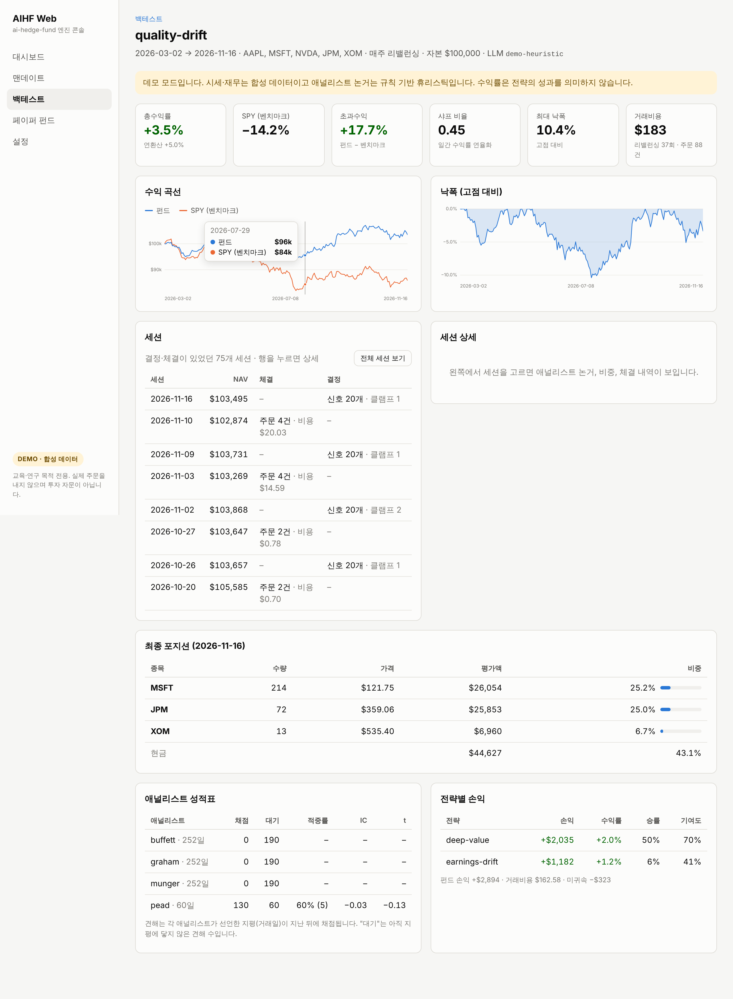

# AIHF Web

오픈소스 [virattt/ai-hedge-fund](https://github.com/virattt/ai-hedge-fund)(PyPI `aihf` v2.7.2) 엔진을 브라우저에서 쓰는 웹앱.
엔진은 수정하지 않고 라이브러리로 의존하며, 그 위에 웹 API(FastAPI)와 웹 UI(React)를 얹었다.

> **교육·연구 목적 전용.** 실제 주문을 내지 않으며 투자 자문이 아니다. 업스트림의 면책 조항을 그대로 따른다.



## 할 수 있는 것

- **맨데이트 설계** — 전략 라이브러리(Deep Value, Earnings Drift, Fundamental L/S, Inflections)나 애널리스트 직접 조합, 자본 배분, 리스크 한도, 리밸런싱 주기
- **백테스트** — 진행률과 함께 실행, 벤치마크 대비 수익·낙폭 곡선, 세션별 애널리스트 논거·비중·체결 드릴다운, 성적표
- **페이퍼 트레이딩** — 맨데이트를 펀드로 배치, 체결될 결정을 확인(승인)한 뒤 한 세션씩 전진, 밀린 세션 따라잡기, 킬 스위치
- **데모 모드** — API 키 없이 전 기능 동작(합성 시세·재무 + 규칙 기반 애널리스트). 화면과 기록에 항상 DEMO/`[demo]` 표기
- **무료 데이터 모드(탐색용)** — 실제 종목을 무료 소스로 돌려 본다: SEC EDGAR 재무(공시일 기준 시점 정합) + Yahoo 시세. LLM 키가 없으면 규칙 기반 애널리스트로 동작

## 빠른 시작

필요: Python 3.11–3.12, [uv](https://docs.astral.sh/uv/), Node 20+

```bash
# 1) UI 빌드
cd frontend && npm ci && npm run build && cd ..

# 2) 서버 실행 (API + 빌드된 UI를 한 프로세스가 서빙)
cd backend && uv sync && uv run uvicorn app.main:app --host 127.0.0.1 --port 8000
```

브라우저에서 <http://127.0.0.1:8000>. 키가 없으면 데모 모드로 시작한다. API 문서는 `/docs`.

개발 중에는 `cd frontend && npm run dev`(포트 5173, `/api`는 8000으로 프록시).

### 무료 데이터 모드

유료 키 없이 실제 종목을 돌려 보는 탐색용 모드다. 설정에서 **SEC 연락처(이메일)** 를 입력하면 켤 수 있다.
SEC는 자동화 클라이언트가 실제 연락처로 자신을 밝히고 초당 10회 이하로 요청하길 요구한다(앱이 요청 간격을 지키며, 가짜 주소는 쓰지 말 것).

| 항목 | 내용 |
| --- | --- |
| 재무 | SEC EDGAR XBRL. 항목마다 공시일이 있어 "그날 공개된 값"만 보인다. 태그로 TTM을 재구성한 **근사값**이며 회사마다 결측이 있다 |
| 시세 | Yahoo 차트 엔드포인트(비공식). 분할 조정, 배당 미조정. 예고 없이 바뀌거나 제한될 수 있다 |
| 한계 | 애널리스트 추정치가 없어 **PEAD는 신호가 없다**. 뉴스·내부자 거래·스크리너 없음. 섹터는 SIC 기반의 거친 분류 |
| 애널리스트 | 선택한 모델의 키가 있으면 실제 LLM, 없으면 규칙 기반(`[demo]`). 어느 쪽인지 리포트에 표기 |

결과는 탐색용이다. 재구성된 재무와 비공식 시세는 성과 근거로 쓰기에 충분히 검증되지 않았다.

### LIVE 모드

설정 화면에서 Financial Datasets 키와 LLM 제공사 키를 등록하고 모드를 LIVE로 바꾼다. 키는 업스트림과 같은
`~/.hedge-fund/.env`에 저장되고, 저장소도 `aihf` CLI/TUI와 같은 `~/.hedge-fund/`를 쓰므로 터미널에서 만든 펀드가 웹에 보인다.

> LIVE 경로는 업스트림 코드(`FDClient`, `make_llm`)를 그대로 호출하지만, 개발 환경에 키가 없어 **실제 호출로 검증하지 못했다.**

## 주의

- **인증이 없는 로컬 단일 사용자 도구다.** 기본 `127.0.0.1` 바인딩을 유지하고 외부에 노출하지 말 것.
- 데모 수익률은 잡음이다. 합성 데이터에는 의도된 우위가 없으며 전략의 성과를 뜻하지 않는다.
- 분 단위(minute) 펀드와 상주 러너는 웹에서 지원하지 않는다(`aihf paper run` 사용).

## 테스트

```bash
cd backend && uv run pytest                 # API·데모·무료 데이터 45건
cd frontend && npm run build                # 타입체크 + 번들
# E2E (Playwright 필요, 빈 홈 디렉터리에서 서버를 띄운 뒤)
AIHF_WEB_HOME=$(mktemp -d) uv run --project backend uvicorn app.main:app --app-dir backend &
node e2e/smoke.mjs
```

## 문서

| 문서 | 내용 |
| --- | --- |
| [01 서비스 기획서](docs/01-product-plan.md) | 배경, 목표, 범위, 리스크 |
| [02 요구사항 명세](docs/02-requirements.md) | 기능·비기능 요구사항 |
| [03 아키텍처 설계](docs/03-architecture.md) | 구조, 모드, 작업 큐, 기술 선택 |
| [04 API 명세](docs/04-api-spec.md) | 엔드포인트와 뷰 모델 |
| [05 UI 설계](docs/05-ui-design.md) | 정보 구조, 화면, 시각 규칙 |
| [06 개발 계획](docs/06-development-plan.md) | 단계, 작업 분해, 테스트 전략 |
| [07 개발 일지](docs/07-dev-log.md) | 진행 기록과 결정, 잡은 문제 |
| [08 검증 리포트](docs/08-test-report.md) | 테스트 결과와 미검증 항목 |
| [09 무료 데이터 어댑터](docs/09-free-data-adapter.md) | EDGAR + Yahoo 모드의 설계와 한계 |
| [10 무료 데이터 정확도 검증](docs/10-free-data-verification.md) | 공시 원문 대조 결과(40/40)와 커버리지 한계 |

## 라이선스

이 저장소의 코드는 MIT. 엔진 `aihf`는 Virat Singh의 MIT 라이선스 소프트웨어이며 수정 없이 의존성으로 사용한다.
투자자 에이전트는 공개된 투자 철학의 양식화된 근사일 뿐 실제 인물이나 그들의 보증이 아니다.
